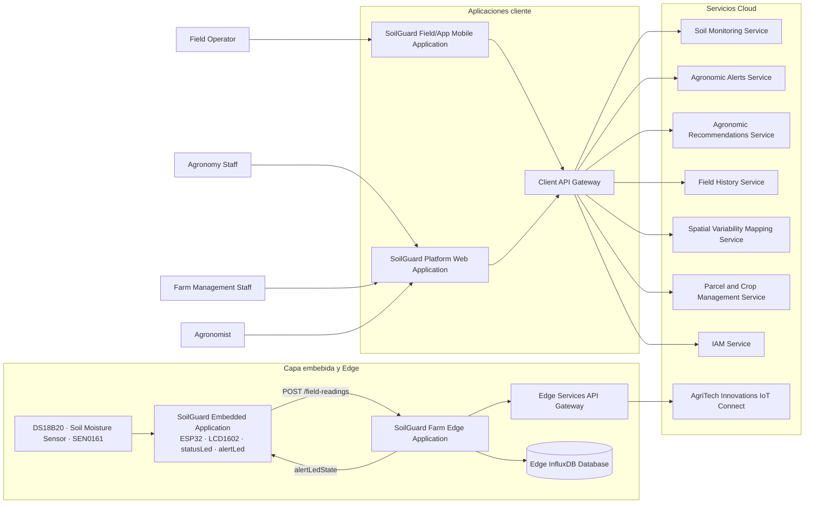

# 1ASI0572 — Desarrollo de Soluciones IoT
## Examen parcial 202610

**NRC:** 6785  
**Estudiante:** Melisa Geraldine Sulca Silva  
**Código:** U202224602

---

## Pregunta 1. Definition of system requirements

**Indicación:** Elabore los requisitos del sistema en términos de capacidades de suministro de energía (*Power Supply*) y restricciones de tiempo (*time-delay*).

| Requisito | Especificación |
|---|---|
| **Capacidades de suministro de energía** | Cada SoilGuard Field Sensor Unit (SGFSU) debe contar con una fuente de alimentación estable para operar en campo agrícola. Se recomienda una batería recargable con soporte de panel solar o una fuente DC protegida, considerando la exposición a humedad, polvo y variaciones ambientales. La fuente debe alimentar el ESP32, los sensores DS18B20, Capacitive Soil Moisture Sensor v2.0 y DFRobot SEN0161, el display LCD 1602, el LED verde de estado y el LED rojo de alerta. También debe incluir regulación de voltaje para proteger los componentes. |
| | Se recomienda una autonomía de **24 a 72 horas** con batería para mantener el monitoreo cuando haya baja radiación solar, desconexión temporal o mantenimiento. En modo de bajo consumo, la SGFSU puede reducir la frecuencia de transmisión, pero debe priorizar las alertas críticas de estrés hídrico o acidez. |
| **Restricciones de time-delay** | La SGFSU debe leer la temperatura, la humedad volumétrica y el pH del suelo cada **5 a 15 minutos**. En operación normal, debe enviar datos al SoilGuard Farm Edge Gateway mediante el endpoint REST `/field-readings` como máximo cada **15 minutos**. |
| | Si detecta una condición crítica —por ejemplo, estrés hídrico severo, humedad bajo el umbral o pH fuera del rango aceptable—, debe enviar los datos en un máximo de **30 a 60 segundos**. |
| | El Farm Edge Gateway debe validar los umbrales del cultivo activo y responder con `alertLedState` en un máximo de **1 a 3 segundos**. El LED rojo debe activarse casi inmediatamente después de recibir `alertLedState = 1`. El tiempo total desde la lectura crítica hasta la señalización visual local no debería superar **5 segundos**. |
| | Las recomendaciones agronómicas, la planificación de riego, la fertilización diferenciada y los mapas de variabilidad espacial pueden actualizarse cada **15 minutos a 1 hora**, porque apoyan el análisis y la toma de decisiones, no una respuesta instantánea. |

---

## Pregunta 2. Definition of physical layer requirements

**Indicación:** Defina los requisitos de la capa física considerando cantidad y tipos de nodos, incertidumbre objetivo de los sensores, exactitud y precisión de los actuadores y capacidad de procesamiento en el Edge node.

| Requisito | Especificación |
|---|---|
| **Número y tipos de nodos sensores y actuators** | En cada zona de cultivo o parcela puede haber una o más SoilGuard Field Sensor Unit (SGFSU). Cada SGFSU funciona como un nodo IoT embebido basado en ESP32 e integra tres sensores: DS18B20 para temperatura del suelo, Capacitive Soil Moisture Sensor v2.0 para humedad volumétrica y DFRobot SEN0161 para pH. |
| | Cada SGFSU integra tres actuadores: LCD 1602 para mostrar temperatura, humedad y pH; LED verde (`statusLed`) para indicar operación normal; y LED rojo (`alertLed`) para indicar una condición de alerta cuando un parámetro está fuera del umbral agronómico del cultivo activo. |
| | Cada finca dispone de un SoilGuard Farm Edge Gateway que actúa como nodo Edge y Fog. Recibe los datos de las SGFSU mediante `/field-readings`, valida los umbrales del cultivo activo y responde con `alertLedState`. |
| **Target uncertainty de los sensores** | Para la temperatura del suelo medida con DS18B20, se propone una incertidumbre objetivo de aproximadamente **±0,5 °C**. Para la humedad volumétrica, se propone **±3 % a ±5 % VWC**, considerando calibración por tipo de suelo. Para el pH medido con DFRobot SEN0161, se propone **±0,1 a ±0,2 pH**. |
| **Target accuracy and precision de los actuadores** | El LCD 1602 debe mostrar de forma legible y estable la temperatura en °C, la humedad volumétrica en % y el pH. El LED verde debe encenderse cuando la SGFSU opere normalmente y las condiciones estén dentro de los rangos aceptables. El LED rojo debe encenderse si el Farm Edge Gateway devuelve `alertLedState = 1` y apagarse si devuelve `alertLedState = 0`. La decisión final de alerta depende del Edge Gateway, que valida los umbrales del cultivo activo. |
| **Processing Power** | La SGFSU con ESP32 requiere capacidad de procesamiento ligera para leer los sensores, construir el payload, actualizar el LCD, enviar datos mediante HTTP/REST al Edge Gateway e interpretar la respuesta `alertLedState`. |
| | El SoilGuard Farm Edge Gateway requiere mayor capacidad de procesamiento porque recibe lecturas de múltiples SGFSU, valida los umbrales por cultivo activo, almacena temporalmente telemetría y sincroniza datos con Cloud Backend o AgriTech Innovations IoT Connect. |

---

## Pregunta 3. Definition of information layer requirements

**Indicación:** Defina los usuarios finales, los servicios que se ofrecerán a cada uno y la información necesaria para implementar esos servicios.

### Usuarios finales

- **Agronomy staff:** analiza condiciones edáficas y recomendaciones agronómicas.
- **Farm management staff:** supervisa zonas de cultivo, parcelas, uso de agua e insumos.
- **Field operators:** consultan las condiciones de campo y realizan acciones operativas mediante la aplicación móvil.
- **Agronomists:** monitorean indicadores, alertas y recomendaciones de riego, fertilización y enmienda de pH.

### Servicios por usuario

Para los **field operators** se plantean tres servicios:

1. Consulta móvil de lecturas por zona.
2. Recepción de alertas de estrés hídrico o acidez crítica.
3. Visualización de acciones recomendadas.

Para los **agronomists** se plantean cuatro servicios:

1. Monitoreo en tiempo real.
2. Alertas agronómicas.
3. Recomendaciones de riego, fertilización y enmienda.
4. Consulta del historial por cultivo o parcela.

### Necesidades de información integrada

- **Monitoreo en tiempo real:** temperatura del suelo, humedad volumétrica, pH, timestamp, finca, parcela, zona de cultivo, cultivo activo y estado del dispositivo.
- **Alertas:** lecturas actuales, umbrales agronómicos del cultivo activo, `alertLedState`, severidad, tipo de alerta, zona afectada y acciones sugeridas.
- **Recomendaciones automáticas:** datos históricos de humedad, temperatura y pH; tipo de cultivo; etapa fenológica; zona; historial de riego; necesidades hídricas; y reglas de fertilización y enmienda.
- **Mapas de variabilidad espacial:** múltiples lecturas por parcela, ubicación de cada SGFSU, series históricas y patrones de humedad, pH y temperatura.
- **Gestión de identidad y acceso:** usuarios, roles, permisos y tokens mediante AgriTech Innovations Identity and Access Control.
- La información recibida por el Edge Services API Gateway se envía a AgriTech Innovations IoT Connect para su centralización, consulta, análisis y generación de recomendaciones agronómicas.

---

## Pregunta 4. C4 Model Containers Diagram

### Criterios y sustento de decisión

La arquitectura de la plataforma se diseñó con C4 a nivel de contenedores y separa la solución en capas cliente, embebida, Edge y Cloud. Esto representa el recorrido de los datos desde los sensores de campo hasta los servicios backend que procesan la información agronómica.

Se incluye la **SoilGuard Embedded Application**, que se ejecuta en el ESP32 de cada SGFSU. Lee la temperatura del suelo, la humedad volumétrica y el pH; actualiza el LCD 1602; y controla los LEDs de estado y alerta.

También se incluye una **Edge InfluxDB Database** para almacenar temporalmente lecturas, alertas y datos de sincronización cuando la conexión con la nube sea intermitente.

### Componentes principales

- **Usuarios:** Agronomy Staff, Farm Management Staff, Field Operator y Agronomist.
- **Aplicaciones cliente:** SoilGuard Platform Web Application y SoilGuard Field/App Mobile Application.
- **Nodo de campo:** SoilGuard Embedded Application, SoilGuard Field Sensor Unit Hardware y SoilGuard Farm Edge Application.
- **Capa Edge:** Edge Services API Gateway y Edge InfluxDB Database.
- **Servicios de plataforma:** Client API Gateway, IAM Service, Soil Monitoring Service, Agronomic Alerts Service, Agronomic Recommendations Service, Field History Service, Spatial Variability Mapping Service y Parcel and Crop Management Service.
- **Bases de datos:** IAM PostgreSQL Database, Monitoring InfluxDB Database, Alerts PostgreSQL Database, Recommendations PostgreSQL Database, Field History PostgreSQL Database, Spatial Analytics PostgreSQL Database y Parcel and Crop PostgreSQL Database.
- **Sistemas externos:** AgriTech Innovations Identity and Access Control, CropIntel y AgriTech Innovations IoT Connect.

### Representación resumida del diagrama

> La plantilla indica pegar una imagen del diagrama C4 elaborado con C4 Model. El Mermaid de arriba resume los contenedores principales; el diagrama original incluye más relaciones entre servicios y bases de datos.
